# Execution Plan — 1:1OS

**Version**: 1.0
**Date**: 2026-03-01
**Status**: Awaiting Approval

---

## Detailed Analysis Summary

### Change Impact Assessment

| Impact Area            | Present | Description                                                                 |
|------------------------|---------|-----------------------------------------------------------------------------|
| User-facing changes    | YES     | Entire product is user-facing — all 8 epics directly affect Design Manager UX |
| Structural changes     | YES     | New multi-component architecture: frontend, API layer, AI services, DB       |
| Data model changes     | YES     | 6+ entities: Manager, Teammate, Profile, Meeting, Pattern, Commitment        |
| API changes            | YES     | New REST API surface (Next.js API routes) + 3 external integrations          |
| NFR impact             | YES     | Performance (10s brief), multi-user isolation, voice audio lifecycle, scalability |

### Risk Assessment

| Attribute              | Assessment |
|------------------------|------------|
| **Risk Level**         | High       |
| **Rationale**          | AI-powered outputs with quality requirements, multiple external APIs (Claude, Whisper), multi-user data isolation, voice audio pipeline, long-term pattern memory |
| **Rollback Complexity**| Moderate — stateless API design, Supabase managed infra |
| **Testing Complexity** | Complex — AI outputs require structured validation, voice pipeline needs E2E testing |

---

## Workflow Visualization

### Mermaid Diagram

```mermaid
flowchart TD
    Start(["User Request"])

    subgraph INCEPTION["INCEPTION PHASE"]
        WD["Workspace Detection<br/><b>COMPLETED</b>"]
        RE["Reverse Engineering<br/><b>SKIPPED</b>"]
        RA["Requirements Analysis<br/><b>COMPLETED</b>"]
        US["User Stories<br/><b>COMPLETED</b>"]
        WP["Workflow Planning<br/><b>COMPLETED</b>"]
        AD["Application Design<br/><b>EXECUTE</b>"]
        UG["Units Generation<br/><b>EXECUTE</b>"]
    end

    subgraph CONSTRUCTION["CONSTRUCTION PHASE - Per Unit x5"]
        FD["Functional Design<br/><b>EXECUTE</b>"]
        NFRA["NFR Requirements<br/><b>EXECUTE</b>"]
        NFRD["NFR Design<br/><b>EXECUTE</b>"]
        ID["Infrastructure Design<br/><b>EXECUTE</b>"]
        CG["Code Generation<br/><b>EXECUTE</b>"]
        BT["Build and Test<br/><b>EXECUTE</b>"]
    end

    subgraph OPERATIONS["OPERATIONS PHASE"]
        OPS["Operations<br/><b>PLACEHOLDER</b>"]
    end

    Start --> WD
    WD --> RE
    RE --> RA
    RA --> US
    US --> WP
    WP --> AD
    AD --> UG
    UG --> FD
    FD --> NFRA
    NFRA --> NFRD
    NFRD --> ID
    ID --> CG
    CG -.->|"Next Unit"| FD
    CG --> BT
    BT -.-> OPS
    BT --> End(["Complete"])

    style WD fill:#4CAF50,stroke:#1B5E20,stroke-width:3px,color:#fff
    style RE fill:#BDBDBD,stroke:#424242,stroke-width:2px,stroke-dasharray: 5 5,color:#000
    style RA fill:#4CAF50,stroke:#1B5E20,stroke-width:3px,color:#fff
    style US fill:#4CAF50,stroke:#1B5E20,stroke-width:3px,color:#fff
    style WP fill:#4CAF50,stroke:#1B5E20,stroke-width:3px,color:#fff
    style AD fill:#FFA726,stroke:#E65100,stroke-width:3px,stroke-dasharray: 5 5,color:#000
    style UG fill:#FFA726,stroke:#E65100,stroke-width:3px,stroke-dasharray: 5 5,color:#000
    style FD fill:#FFA726,stroke:#E65100,stroke-width:3px,stroke-dasharray: 5 5,color:#000
    style NFRA fill:#FFA726,stroke:#E65100,stroke-width:3px,stroke-dasharray: 5 5,color:#000
    style NFRD fill:#FFA726,stroke:#E65100,stroke-width:3px,stroke-dasharray: 5 5,color:#000
    style ID fill:#FFA726,stroke:#E65100,stroke-width:3px,stroke-dasharray: 5 5,color:#000
    style CG fill:#4CAF50,stroke:#1B5E20,stroke-width:3px,color:#fff
    style BT fill:#4CAF50,stroke:#1B5E20,stroke-width:3px,color:#fff
    style OPS fill:#BDBDBD,stroke:#424242,stroke-width:2px,stroke-dasharray: 5 5,color:#000
    style INCEPTION fill:#BBDEFB,stroke:#1565C0,stroke-width:3px,color:#000
    style CONSTRUCTION fill:#C8E6C9,stroke:#2E7D32,stroke-width:3px,color:#000
    style OPERATIONS fill:#FFF59D,stroke:#F57F17,stroke-width:3px,color:#000
    style Start fill:#CE93D8,stroke:#6A1B9A,stroke-width:3px,color:#000
    style End fill:#CE93D8,stroke:#6A1B9A,stroke-width:3px,color:#000
    linkStyle default stroke:#333,stroke-width:2px
```



### Text Alternative

```
INCEPTION PHASE
  [x] Workspace Detection        — COMPLETED
  [x] Reverse Engineering        — SKIPPED (Greenfield)
  [x] Requirements Analysis      — COMPLETED
  [x] User Stories               — COMPLETED
  [x] Workflow Planning          — COMPLETED (this document)
  [ ] Application Design         — EXECUTE
  [ ] Units Generation           — EXECUTE

CONSTRUCTION PHASE (repeat for each of 5 units)
  [ ] Functional Design          — EXECUTE per unit
  [ ] NFR Requirements           — EXECUTE per unit
  [ ] NFR Design                 — EXECUTE per unit
  [ ] Infrastructure Design      — EXECUTE per unit
  [ ] Code Generation            — EXECUTE per unit (ALWAYS)
  [ ] Build and Test             — EXECUTE (after all units)

OPERATIONS PHASE
  [ ] Operations                 — PLACEHOLDER
```

---

## Phases to Execute

### INCEPTION PHASE

- [x] **Workspace Detection** — COMPLETED
  - Greenfield project confirmed, no existing code
- [x] **Reverse Engineering** — SKIPPED
  - Rationale: Greenfield project, no existing codebase to analyze
- [x] **Requirements Analysis** — COMPLETED
  - 8 FRs, 9 NFRs, full tech stack defined
- [x] **User Stories** — COMPLETED
  - 17 BDD stories across 8 feature epics
- [x] **Workflow Planning** — COMPLETED (this document)
- [ ] **Application Design** — EXECUTE
  - Rationale: New multi-component system with 6+ distinct components (Auth, Profile, Meeting Ingestion, AI Analysis, Intelligence Engine, Tracker/Timeline), 3 external service integrations (Claude, Whisper, Supabase), and complex service orchestration. Component boundaries, method signatures, and service dependencies must be defined before unit decomposition.
- [ ] **Units Generation** — EXECUTE
  - Rationale: System decomposes naturally into 5 units with different dependencies and development priorities. Units must be defined and sequenced before Construction begins.

### CONSTRUCTION PHASE

Per-unit loop executes for each of the **5 proposed units** (see Unit Proposals below):

- [ ] **Functional Design** — EXECUTE (per unit)
  - Rationale: New data models (6+ entities), complex business logic (AI prompt construction, commitment extraction logic, pattern detection algorithms, brief assembly)
- [ ] **NFR Requirements** — EXECUTE (per unit)
  - Rationale: Performance SLAs (10s brief, 15s pattern analysis), multi-user data isolation, voice audio lifecycle management, external API failure handling
- [ ] **NFR Design** — EXECUTE (per unit)
  - Rationale: Follows NFR Requirements execution; patterns needed for caching AI responses, retry logic, rate limiting, row-level security
- [ ] **Infrastructure Design** — EXECUTE (per unit)
  - Rationale: Multiple cloud services need mapping (Supabase Postgres + Auth + Storage, Claude API, Whisper/Deepgram, Vercel serverless functions). Resource specifications and integration patterns required.
- [ ] **Code Generation** — EXECUTE (per unit, ALWAYS)
- [ ] **Build and Test** — EXECUTE (after all units complete, ALWAYS)

### OPERATIONS PHASE

- [ ] **Operations** — PLACEHOLDER (future deployment and monitoring workflows)

---

## Proposed Unit Decomposition (5 Units)

These will be formally defined and approved in the Units Generation stage.

| Unit | Name                    | Key Stories                              | External Dependencies          |
|------|-------------------------|------------------------------------------|--------------------------------|
| 1    | Foundation              | US-01, US-02, US-16 (Auth + DB schema)   | Supabase Auth, Prisma          |
| 2    | Teammate Profiles       | US-03, US-04 (Profile + AI interview)    | Claude API                     |
| 3    | Meeting Ingestion       | US-05–US-08, US-17 (Ingest + Commitments)| Claude API, Whisper/Deepgram, Supabase Storage |
| 4    | Intelligence Engine     | US-09, US-10, US-11, US-12 (Patterns + Brief + Coaching) | Claude API |
| 5    | Tracker & Timeline      | US-13, US-14, US-15 (Commitments + Timeline) | None (internal data only) |

**Recommended build sequence**: Unit 1 → Unit 2 → Unit 3 → Unit 4 → Unit 5
- Unit 1 must be first (foundation: DB schema, auth, middleware)
- Units 2–3 can partially overlap (both depend on Unit 1 only)
- Unit 4 depends on Unit 3 (needs ingested meeting data)
- Unit 5 depends on Units 3–4 (commitment data from ingestion, patterns from intelligence)

---

## Success Criteria

| Criterion                       | Target                                              |
|---------------------------------|-----------------------------------------------------|
| Primary Goal                    | Deployable web app: manager can run full 1:1 workflow from profile → ingest → brief |
| All 17 user stories implemented | US-01 through US-17 with passing acceptance criteria |
| AI integration live             | Claude API generating real briefs and patterns      |
| Voice pipeline working          | Record → transcribe → extract commitments end-to-end |
| Multi-user isolation verified   | No data leakage between manager accounts            |
| Build passing                   | All unit tests and integration tests green          |
